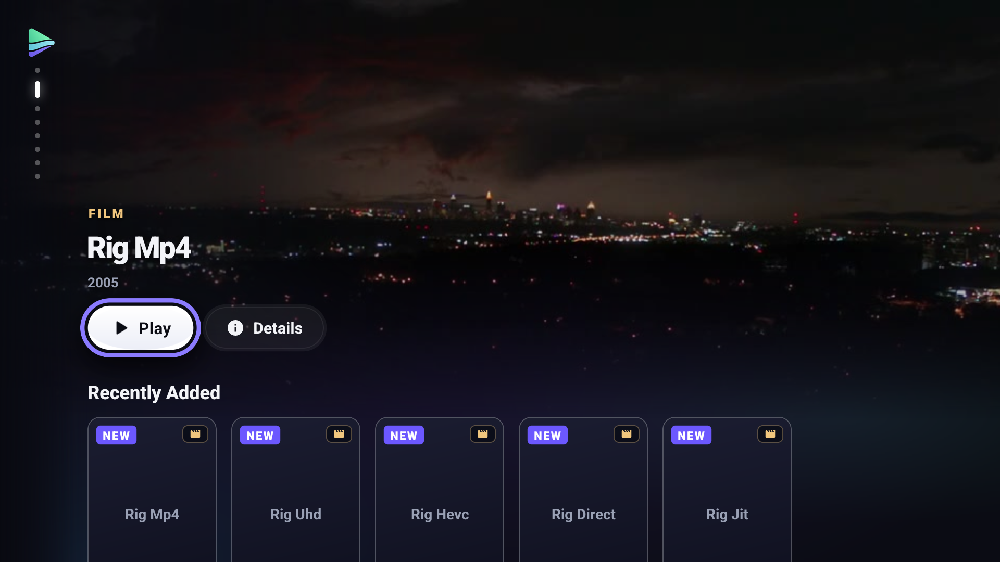
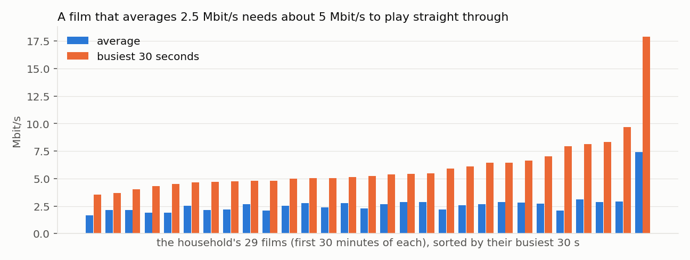
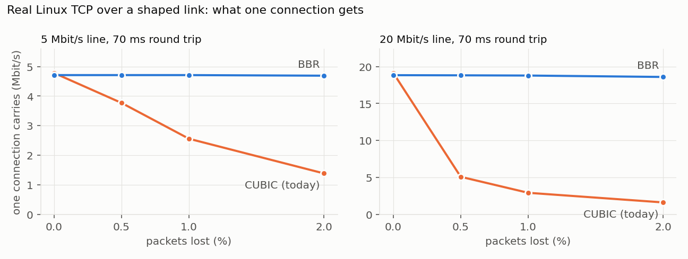
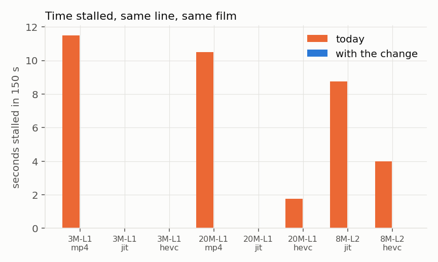
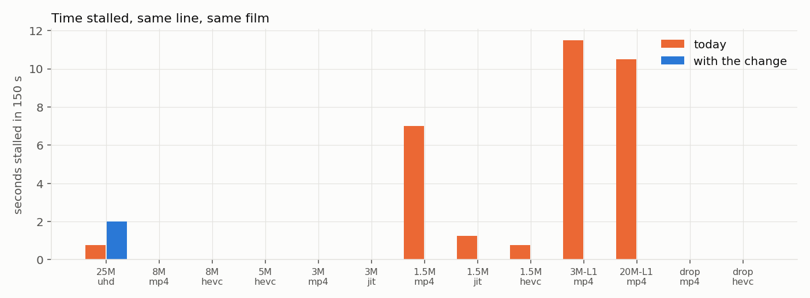
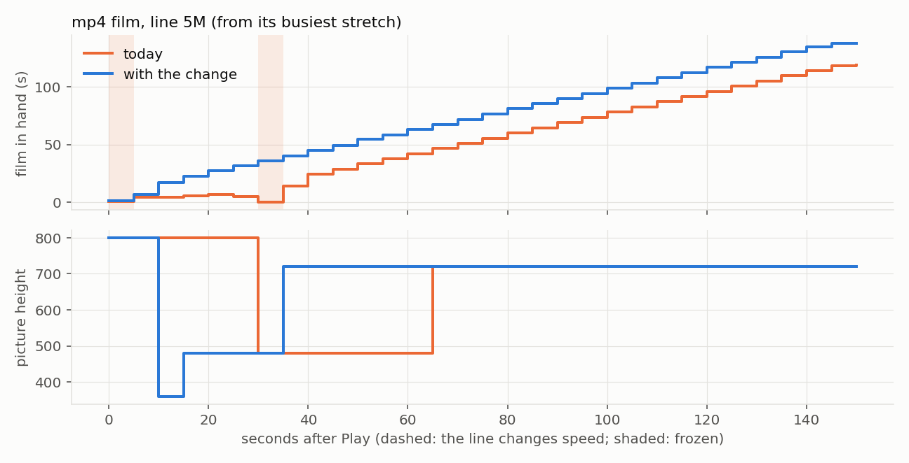
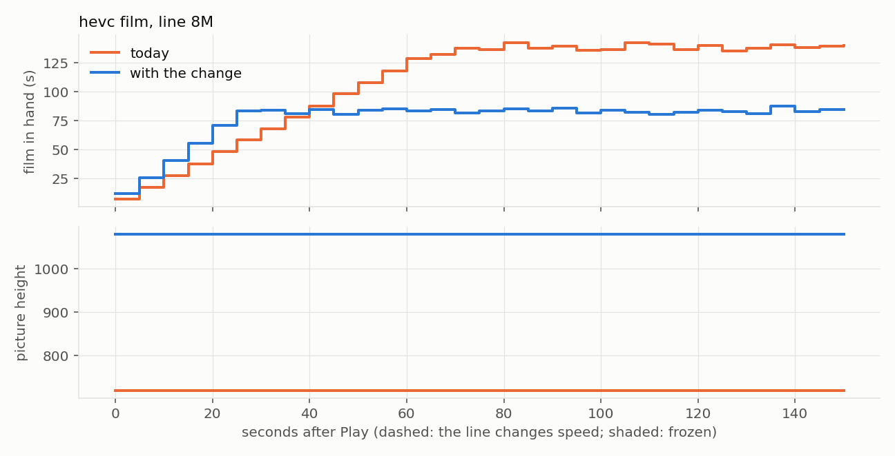

# Streaming that does not stop — why Netflix felt better, and what closes the gap

*2026-11-27 · branch `research-stream-efficiency` (from master `31bfa397`, server 1.15.45). Research, a measuring rig,
and prototypes. **2026-11-28: elia chose what gets built — everything except more encoding on the server, and the
sound stays as it is. It is built, on by default, rebased on master 1.15.46: see "Built" right below the summary.**
Nothing here is released.*

## In plain words (one screen)

**Why Netflix played and Aurora stopped on the same connection — the main reasons, most important first:**

1. **How the server sends, when packets get lost on the way.** nufurora.com uses Linux's standard way of pacing a
   connection (CUBIC). It slows down hard every time a packet is lost, and from 72 ms away (Germany → Israel) it takes
   seconds to speed up again. Measured on real Linux: on a 20 Mbit/s line that loses 1 packet in 100, one connection
   carries **2.9 Mbit/s** with CUBIC and **18.8 Mbit/s** with BBR (what Google uses; Netflix uses its own tuned stack).
   In the player that is the difference between 10.5 s of stops at 545p and **no stop at the full picture**. Changing it
   is a 5-minute server setting that elia can do (§6) — and it helps the TV with no new app.
2. **Aurora has one copy of each film; Netflix has a dozen sizes.** The household's films are web releases whose busy
   scenes need **2.2× their average bitrate** (median of all 29 films): a "2.5 Mbit/s" film needs about 5 Mbit/s for its
   action scenes. When Chrome plays the file itself it keeps only **2–6 seconds** in hand, so the first busy scene on a
   thinner line stops the picture; only then does Aurora switch to a lighter version. The **TV and the iPhone never
   switch by themselves at all.** Netflix starts every film on a ladder of sizes, holds minutes in hand, and steps down
   *before* the buffer runs out.
3. **When Aurora does have a ladder, it often picks a worse picture than the line can carry — and sends more bytes.**
   It judges each version by its single busiest moment: on an 8 Mbit/s line an HEVC film played the whole time as a
   720p re-encode at 4.8 Mbit/s instead of its own 1080p at 3.0. A 4K film on 25 Mbit/s spent 87 % of the time below 4K.
4. **The lighter versions are made live, as fast as possible, and there is nothing under 480p.** Encoded with the
   fastest setting while the viewer waits, they look worse per bit than they need to (VMAF 74 at 480p where a slower
   setting gives 80 for the same bits, or HEVC the same look for 45 % fewer bits), and a 1.5 Mbit/s line has no version
   it can carry.

**What closes the gap (§5 has the full ranked plan with numbers):**

| | Change | Measured effect | Who does it |
|---|---|---|---|
| 1 | BBR on nufurora.com | lossy lines: every stall gone, full picture back (TV included, no new app) | elia, 5 min, §6 |
| 2 | Website starts films on the ladder unless the line is known to be fast, plus a 360p rung (built without the 360p rung: copy-first, see Built) | the file's stalls → 0 on 1.5 Mbit/s, on lossy lines and in busy scenes; first frame 3.6 → 1.1 s on 1.5 Mbit/s | code, small (prototype on the branch) |
| 3 | Pick ladder rungs by their average once the buffer is deep | 8 Mbit/s: 720p → full 1080p with **38 % fewer bytes**; 4K at 4K 13 % → 60 % of the time | code, small (prototype) |
| 4 | Fix two freezes found by the rig | two ways the picture froze for good | code, small |
| 5 | Make the lighter rungs overnight, with a better encoder (not built: elia, no more encoding) | +5–6 VMAF for the same bits, or 30–45 % fewer bits; no waiting on an encoder | code, medium |

Netflix's global cache network, per-shot encoding and AV1 were looked at and do not fit a one-server household (§7).
The TV and iPhone parts could not be measured on the devices in this task; exact checks are in §8.

---

## Built (2026-11-28) — what is now on the branch, with its numbers

elia's decision: everything that improves streaming **except more encoding on the server** ("at the end it
just ends up being slower for the user"), and later the same day: **don't make the sound smaller**. So the
360p rung, overnight prepared rungs, the TV's automatic step-down to an encode and the iPhone encoded ladder
were dropped (the 360p rung's code is removed, not just switched off), and the copy's AAC stays 192k (it was
lowered to 128k for a few hours; reverted, `4d5236fc` — the copy's sound is master's again).

**The rule that held everything: no video encode may run that would not have run before.** The rig now counts
every video encode the server starts (`tools/stream-net-rig/count-encodes.js`, preloaded into the private
instance: every ffmpeg launched with a video encoder, boot probes excluded). The "before" is master
(`31bfa397`, a frozen copy played by the same rig, `--tree`); the "after" is this branch. Video copies and
remuxes into segments, and the copy's sound re-encode, are not encodes by that rule and are not counted.

| # | Built | Where (files) | On by default | Off switch |
|---|---|---|---|---|
| 1a | A jit stream the server refuses **after** it started (its own picture answers 404 — jit declined the file's index) is left once, the way it came: the file itself, the offset stream, or — after a step-down — the capped encode the step-down would have taken had the ladder been refused up front. It used to be retried every 2 s for ever (picture frozen for good). A ladder dropped to one rendition is an ordinary jit stream again, so the stall rule applies. | `public/js/screens/player.js` (`jitFallback`, `backToFile`, the refusal check in the hls ERROR handler, the one-rung rule in the ladder's ERROR hook) | yes | — (a fix) |
| 1b | An **encoded** rendition never "bridges" a damaged stretch of the index: its encodes are declined for that file instead (the copy still bridges, as before). The 4K film's open-GOP cue at 10.457 s decodes as no keyframe, so its 720p/480p segment 1 was segment 0's bytes again, and a player that moved onto that rung at that seam froze for good. | `src/media/jit.js` (`advance`) | yes | — (a fix) |
| 1c | An **offset encode that dies** (ffmpeg fails on a damaged stretch) is not started again by the player's next playlist poll — that was a new encoder every few seconds, 36 and 47 of them in one 150-s play on the rig's damaged clip; only a viewer's seek may try once more, and after two failures the place answers 404 for 10 minutes. A step-down off the file onto such an encode goes **back to the file** when the encode is refused, and steps down no more for that film. | `src/media/remux.js` (`failed`, `failedHere`), `src/routes/stream.js` (`sendStreamError`), `public/js/screens/player.js` (`stepDown`: `fileIfRefused`; a refused address is a ladder rung only when it is a `/jit/` one) | yes | — (a fix) |
| 2 | **Copy-first**: a film this browser plays as the file, on a line not known to carry 2.2× its average (unknown included), opens as its own picture copied into the **single** jit playlist — ~100 s held by hls.js, nothing encoded, no master, no lighter rendition until the existing stall rule would step down anyway (the watcher treats that stream as the file: no step-down on a short buffer alone). Busy server or no index: the file, at once. Not on native HLS (iPhone). A line known to be fast keeps the file. | `public/js/playstart.js` (`fileNeedsBuffer`), `public/js/screens/player.js` (`copyBeatsFile`, `copyFirstUrl`, `startPlan`) | yes | `localStorage["aurora-ladder-first"] = "0"` on a device |
| 3 | **Rungs by their average with a deep buffer**: on a ladder of two codecs (HEVC copy + H.264 rungs) a rung needs 1.25× its **average** once 30 s and 3× its busiest segment's fetch are in hand (else today's busiest-segment × 1.4); a known line starts on the rung whose average fits; the start watch does not step a line known to carry that average down onto an encode. | `public/js/playstart.js` (`rungNeeds`), `public/js/screens/player.js` (`ladderBest`, `ladderApply`, start watch) | yes | `localStorage["aurora-ladder-avg"] = "0"` |
| 4 | **Honest copy rate**: the copy rung's declared BANDWIDTH/AVERAGE-BANDWIDTH no longer count the file's own audio tracks (which the copy does not send; one ffprobe per file, kept on disk with the ladder facts), plus the 192k AAC it does send. | `src/media/ladder.js` (`copyBandwidth`, `otherStreamsBps`, `withOthers`) | yes | — |
| 5 | ~~AAC 192k → 128k~~ — **dropped** by elia; reverted. | — | — | — |
| 6 | A deeper hls.js forward buffer on desktop — **not built**: the rig showed no gain (below). | — | — | — |
| 7 | **TV start buffer 1000 → 2500 ms** (server tuning, no APK), measured on the Mi TV. | `src/lib/tvtuning.js` (`DEFAULT_PLAYER`) | yes | config.json `"tvPlayer": { "startBufferMs": 1000 }` |

Nothing visible changed: no new toast, control, label or look. What a viewer may notice: on a line not known to
be fast, the first frame of a file-playable film comes from the stream (sooner on a thin line), and a 5.1 file
played that way is heard as the stereo AAC every jit stream already sends (as on every HEVC-in-MKV film today).

### The numbers — master against the branch, same rig, same lines, encoder starts counted

Real Chrome through the WSL2-shaped line (§ Appendix A), 150 s watched per play, 3 plays on every deciding cell
(medians; "encoder starts" is the sum over all plays of that cell). Before = master `31bfa397` (data
`built-before*.jsonl`), after = this branch (`built-final*.jsonl`; the 25M 4K row is `built-final-uhd.jsonl`, played
again after the rung-drop fix `1d7b70bf`).

The deciding cells:

| line | film | first frame | stalled (count) | avg height | at full height | delivered | encoder starts (all plays) | at the end |
|---|---|--:|--:|--:|--:|--:|--:|---|
| 25M | uhd (3×) | 0.7 → **0.7** s | 5.3 s (3) → **11 s (2)** | 833p → **713p** | 13% → **12%** | 5.2 → **4.4** Mbit/s | 14 → **9** | playing → **playing** |
| 8M | hevc (3×) | 0.6 → **0.6** s | 0 s (0) → **0 s (0)** | 720p → **1080p** | 0% → **100%** | 4.8 → **3** Mbit/s | 5 → **0** | playing → **playing** |
| 5M | hevc (3×) | 2.9 → **0.9** s | 0 s (0) → **0 s (0)** | 612p → **781p** | 0% → **37%** | 3.6 → **3** Mbit/s | 18 → **15** | playing → **playing** |
| drop | hevc (3×) | 1.2 → **1.2** s | 0 s (0) → **0 s (0)** | 805p → **807p** | 54% → **52%** | 3.4 → **3.3** Mbit/s | 10 → **10** | playing → **playing** |

Films that play as the file, from 6:30 (their busiest stretch), the line known to the player:

| line | film | first frame | stalled (count) | avg height | at full height | delivered | encoder starts (all plays) | at the end |
|---|---|--:|--:|--:|--:|--:|--:|---|
| 5M | mp4 (3×) | 5.2 → **3.9** s | 0 s (0) → **0 s (0)** | 800p → **800p** | 100% → **100%** | 4.4 → **4.7** Mbit/s | 0 → **0** | playing → **playing** |
| 3M | mp4 (3×) | 5 → **6** s | 5.7 s (3) → **4.8 s (3)** | 506p → **496p** | 8% → **5%** | 2.7 → **2.7** Mbit/s | 9 → **8** | playing → **playing** |

A lossy line (1 % loss, the player told 2.7 Mbit/s):

| line | film | first frame | stalled (count) | avg height | at full height | delivered | encoder starts (all plays) | at the end |
|---|---|--:|--:|--:|--:|--:|--:|---|
| 3M-L1 | mp4 (3×) | 1.9 → **0.8** s | 5 s (2) → **3.7 s (1)** | 521p → **514p** | 13% → **11%** | 2.1 → **2.1** Mbit/s | 8 → **9** | playing → **playing** |

**Encoder starts over the deciding cells: 64 before → 51 after.** Per cell it went down or stayed, except the lossy line
(8 → 9): both sides step down onto the 480p encode exactly once in every play (3 → 3 step-downs); each step-down
starts 2 or 3 ffmpeg processes (the fast first segment, the hand-over to the ladder's preset, sometimes a second
producer), and the after side happened to start 3 in all three plays. No play on the branch started an encode on a
line where master started none.

Where it is worse, said plainly — **the 4K film on 25 Mbit/s** (11 s stalled against 5 s, 713p against 833p, 9
encoder starts against 14): this one film's index has a cue at 10.457 s that decodes as no keyframe. Master's
encoded rungs "bridged" it — and on 8 Mbit/s that froze the picture for good (1 of 3 plays below, 2 of 3 in the
earlier rerun; the #4b freeze). The
branch declines encodes across a bridge (1b), so on 25 Mbit/s the film starts on the copy alone, the copy's doubled
segment at that seam takes ~10 s, and only then does the stall rule step down (onto the offset encode, as without a
ladder). Master happened to leave the copy for the 480p rung by its own estimate before the seam. A later fix
belongs in jit (a copy segment that does not double at a bridge), not in the player.

The rest of the lines, one play each (data `built-before.jsonl` / `built-after.jsonl` — the branch as it was in the
first matrix, before the copy-first watcher fix `d2bbb079` and the rung-drop fix): every cell plays to the end on
both sides, and the encoder starts are equal cell by cell except 3M jit (2 → 3: one play each, the same single
step-down onto the 480p rung, one more ffmpeg for its hand-over).

| line | film | first frame | stalled (count) | avg height | at full height | delivered | encoder starts (all plays) | at the end |
|---|---|--:|--:|--:|--:|--:|--:|---|
| 25M | mp4 | 0.6 → **0.6** s | 0 s (0) → **0 s (0)** | 800p → **800p** | 100% → **100%** | 3 → **3.3** Mbit/s | 0 → **0** | playing → **playing** |
| 8M | jit | 0.5 → **0.6** s | 0 s (0) → **0 s (0)** | 800p → **800p** | 100% → **100%** | 3.5 → **3.6** Mbit/s | 0 → **0** | playing → **playing** |
| 8M | mp4 | 0.9 → **0.9** s | 0 s (0) → **0 s (0)** | 800p → **800p** | 100% → **100%** | 3 → **3** Mbit/s | 0 → **0** | playing → **playing** |
| 5M | mp4 | 1.1 → **0.6** s | 0 s (0) → **0 s (0)** | 800p → **800p** | 100% → **100%** | 3 → **3.3** Mbit/s | 0 → **0** | playing → **playing** |
| 3M | hevc | 0.9 → **0.9** s | 0 s (0) → **0 s (0)** | 480p → **480p** | 0% → **0%** | 2.8 → **2.8** Mbit/s | 2 → **2** | playing → **playing** |
| 3M | jit | 0.7 → **1.3** s | 0 s (0) → **0 s (0)** | 480p → **497p** | 0% → **5%** | 2.8 → **2.8** Mbit/s | 2 → **3** | playing → **playing** |
| 3M | mp4 | 1.8 → **0.7** s | 0 s (0) → **0 s (0)** | 800p → **800p** | 100% → **100%** | 2.9 → **2.8** Mbit/s | 0 → **0** | playing → **playing** |
| 1.5M | hevc | 1.1 → **1.1** s | 0.8 s (1) → **0.8 s (1)** | 480p → **480p** | 0% → **0%** | 1.4 → **1.4** Mbit/s | 1 → **1** | playing → **playing** |
| 1.5M | jit | 1.1 → **1.1** s | 1.3 s (1) → **1 s (1)** | 480p → **480p** | 0% → **0%** | 1.4 → **1.4** Mbit/s | 2 → **2** | playing → **playing** |
| 1.5M | mp4 | 3.6 → **1** s | 7.5 s (4) → **6.5 s (4)** | 488p → **490p** | 3% → **3%** | 1.4 → **1.4** Mbit/s | 2 → **2** | playing → **playing** |
| drop | jit | 0.5 → **0.5** s | 0 s (0) → **0 s (0)** | 789p → **800p** | 96% → **100%** | 3.2 → **3.2** Mbit/s | 2 → **2** | playing → **playing** |
| drop | mp4 | 0.7 → **0.7** s | 0 s (0) → **0 s (0)** | 800p → **800p** | 100% → **100%** | 3 → **2.9** Mbit/s | 0 → **0** | playing → **playing** |

The two freezes, 3 plays each (before: master; after: this branch with every fix, data `built-*-repro*.jsonl`):

| line | film | first frame | stalled (count) | avg height | at full height | delivered | encoder starts (all plays) | at the end |
|---|---|--:|--:|--:|--:|--:|--:|---|
| 8M | uhd (3×) | 0.8 → **1.8** s | 5.3 s (1) → **6 s (3)** | 720p → **753p** | 0% → **4%** | 4.8 → **3.5** Mbit/s | 17 → **7** | 1/3 stuck → **playing** |
| 1.5M | direct (3×) | 9.5 → **9.7** s | 140 s (1) → **25.3 s (10)** | 800p → **799p** | 100% → **100%** | 0.1 → **0.6** Mbit/s | 3 → **3** | 3/3 stuck → **3/3 stuck** |

### The two freezes, in words

- **#4b, the 4K film at 8 Mbit/s** (its 720p rung bridged a damaged stretch of the index): master froze for good in 1
  of these 3 plays (130 s stalled; 2 of 3 in the earlier rerun), 17 encoder starts. The branch: **3 of 3 playing**,
  7 encoder starts — the encoded rungs are declined for this film, the copy plays, the stall rule steps down onto
  the offset encode once. Its first frame comes ~1 s later (1.8 s): a known 8 Mbit/s line starts on the 720p rung,
  which is refused and dropped before the copy's first segment.
- **#4a, the damaged MP4 at 1.5 Mbit/s** (the clip whose edit list jit misreads, so every jit request for it is
  refused): master's step-down asked the ladder, was refused, and asked again every 2 s — the picture frozen with
  the spinner for 140 s in **3 of 3** plays, 1 encoder start each. The branch leaves the refused stream at once in
  **3 of 3** plays (the file; then the step-down's offset encode; refused again; the file again), 1 encoder start
  each, as master. The clip does not play through on this line on either side: it is damaged (ffmpeg reports
  decode errors from 0:00 and its encode dies about 20 s in), and on the branch Chrome stops on a decode error at
  0:26 and the player shows its existing error card. **What was a frozen picture for good is now an answer.**
- Found on the way (1c): before the remux fix, this same play on the branch started the dying encode **36 and 47
  times** in 150 s (every playlist poll restarted it; data `built-final-repro.jsonl`, the 1.5M rows). That loop is
  master's too, wherever an offset encode dies (a TV's offset, an iPhone's transcode, a step-down) — the branch
  ends it for everyone: `built-final-repro2.jsonl` (2 starts, the picture still frozen) → `built-final-repro3.jsonl`
  (2 starts, back to the file) → `built-final-repro4.jsonl` (1 start, a poll never restarts a failed job).

### Item 6 — a deeper hls.js forward buffer: not built

The busiest-stretch 10 → 2 → 10 Mbit/s drop, 2 plays each, today's buffer (60 MB, ~100 s at these rates) against
150 MB / 180 s (`--hls`, data `hlsbuf-*.jsonl`):

| line | film | first frame | stalled (count) | avg height | at full height | delivered | encoder starts (all plays) | at the end |
|---|---|--:|--:|--:|--:|--:|--:|---|
| drop | hevc (2×) | 1.8 → **1.8** s | 0 s (0) → **0 s (0)** | 835p → **835p** | 59% → **59%** | 3.4 → **3.4** Mbit/s | 6 → **6** | playing → **playing** |
| drop | mp4 (2×) | 2.2 → **2.4** s | 0 s (0) → **0 s (0)** | 800p → **800p** | 100% → **100%** | 4.8 → **6.5** Mbit/s | 0 → **0** | playing → **playing** |

Already stall-free with today's buffer; the deeper one only fetched 35 % more bytes ahead (bytes a viewer who stops
watching never uses). Phones keep their limits — nothing was changed.

### Item 7 — the TV start buffer, on the Mi TV

A QA build of TV 5.9.9 (`versionCode` raised to 275 for the build only, its only server a private instance of this
branch on this PC behind `tools/throttle-proxy.js`; QA markers reverted, 0 left in the source), throwaway profile
"Claude QA" on that private server, plays opened with the app's own deep link (`aurora://open?a=play`), first frame
and stalls read off the app's play marks (`tools/stream-net-rig/tv-instance.js`, `tv-play.js`, `tv-report.js`;
data `tv-*.jsonl`). `svc power stayon true` after the install; no power keys; nothing else on the TV was touched.



| film | line | from | start buffer | plays | first frame | stalls in the first minute | stalled in the first minute | stalls (all) | stalled (all) |
|---|---|--:|--:|--:|--:|--:|--:|--:|--:|
| hevc | pass-through | 0 s | 1000 ms | 1 | 2.1 s | 0 | 0.0 s | 0 | 0.0 s |
| hevc | pass-through | 546 s | 1000 ms | 4 | 4.5 s | 4 | 29.1 s | 4 | 29.1 s |
| hevc | 4 Mbit/s, 70 ms | 0 s | 1000 ms | 3 | 2.2 s | 1 | 5.1 s | 1 | 5.1 s |
| hevc | 4 Mbit/s, 70 ms | 0 s | 2500 ms | 4 | 3.1 s | 0 | 0.0 s | 0 | 0.0 s |
| hevc | 4 Mbit/s, 70 ms | 0 s | 5000 ms | 3 | 5.6 s | 0 | 0.0 s | 0 | 0.0 s |
| hevc | 6 Mbit/s, 70 ms | 546 s | 1000 ms | 3 | 4.3 s | 4 | 30.3 s | 5 | 37.6 s |
| hevc | 6 Mbit/s, 70 ms | 546 s | 2500 ms | 3 | 6.5 s | 4 | 30.4 s | 5 | 37.5 s |
| hevc | 6 Mbit/s, 70 ms | 546 s | 5000 ms | 3 | 12.2 s | 3 | 32.9 s | 3 | 38.1 s |
| jit | pass-through | 0 s | 1000 ms | 1 | 2.9 s | 1 | 7.4 s | 1 | 7.4 s |
| mp4 | pass-through | 390 s | 1000 ms | 6 | 12.1 s | 3 | 22.8 s | 3 | 22.8 s |
| mp4 | 100 Mbit/s, 4 ms | 0 s | 1000 ms | 2 | 4.2 s | 2 | 11.1 s | 2 | 11.1 s |
| mp4 | 100 Mbit/s, 4 ms | 0 s | 5000 ms | 2 | 9.3 s | 1 | 5.9 s | 1 | 5.9 s |
| mp4 | 4 Mbit/s, 70 ms | 0 s | 1000 ms | 3 | 4.6 s | 2 | 12.6 s | 2 | 12.8 s |
| mp4 | 4 Mbit/s, 70 ms | 0 s | 2500 ms | 3 | 6.4 s | 2 | 11.8 s | 2 | 12.5 s |
| mp4 | 4 Mbit/s, 70 ms | 0 s | 5000 ms | 3 | 9.8 s | 1 | 5.0 s | 2 | 10.3 s |
| mp4 | 4 Mbit/s, 70 ms | 390 s | 1000 ms | 3 | 12.2 s | 4 | 31.5 s | 5 | 39.9 s |
| mp4 | 4 Mbit/s, 70 ms | 390 s | 2500 ms | 3 | 15.2 s | 4 | 31.1 s | 4 | 31.6 s |
| mp4 | 4 Mbit/s, 70 ms | 390 s | 5000 ms | 3 | 18.8 s | 3 | 28.4 s | 3 | 28.4 s |
| mp4 | 8 Mbit/s, 70 ms | 390 s | 1000 ms | 2 | 11.6 s | 4 | 31.3 s | 5 | 39.5 s |
| mp4 | 8 Mbit/s, 70 ms | 390 s | 2500 ms | 2 | 15.1 s | 4 | 30.7 s | 4.5 | 34.7 s |
| mp4 | 8 Mbit/s, 70 ms | 390 s | 5000 ms | 2 | 18.7 s | 1.5 | 14.8 s | 1.5 | 14.8 s |
| orig | pass-through | 0 s | 1000 ms | 1 | 3.0 s | 3 | 18.8 s | 3 | 18.8 s |
| orig | pass-through | 3000 s | 1000 ms | 2 | 7.2 s | 2 | 13.9 s | 2 | 13.9 s |

What it says:

- **From the start of a film on a thin line** (HEVC, 4 Mbit/s, 70 ms): 1000 ms → first frame 2.2 s and an early ~5 s
  stall in 2 of 3 plays; **2500 ms → 3.2 s, 1 of 3 (median none)**; 5000 ms → 5.6 s, none. The default is now
  **2500 ms** (server-side, `src/lib/tvtuning.js`; config.json `tvPlayer.startBufferMs` still wins). A final check
  at 2500: first frame 3.1 s, no stall.
- **A resume stalls whatever the start buffer** — and on a plain LAN pass-through too: an HEVC film resumed mid-way
  stalled 3–4 times (~7 s each) in its first minute at 1000, 2500 and 5000 ms, with `resumeAtSource` on or off; the
  household's own original 2.5-hour HEVC film resumed at 50 min: 2 stalls (13.9 s) in the first minute on the LAN.
  Each stall ended only when the app's own stall nudge (a small seek after ~4 s) fired. **This is a TV-app finding
  for its own round** (not a line problem, not something a server setting fixes): see "TV follow-up" below.
- **H.264 films stalled on the TV from their start even on the LAN** (the MP4 clip twice in its first minute at
  100 Mbit/s; the H.264 MKV once), while the HEVC clip played clean; the original HEVC film from its start stalled
  at 0 s and the app's decode watchdog moved it onto the transcode (`transcode=true`) — also for the TV round.

TV follow-up (exact repro, private server only): `node tools/stream-net-rig/tv-instance.js --listen 47400 --cmd
<file>`, a QA build whose only server is `http://<this PC>:47400`, then `node tools/stream-net-rig/tv-play.js --cmd
<file> --log <its log> --title hevc --at 546 --down 0 --lat 0 --start 1000 --watch 70`; read `stall` /
`stall-nudge` / `stall-end` marks; `adb logcat -s ReactNativeJS ExoPlayerImpl` around the stall. Suspects to rule
out first: the app's stall nudge itself re-seeking a progressive MKV/MP4 source (each nudge is followed by the next
stall ~7 s later), and the proxy (a Node relay in every TV play here, even "pass-through").

### Tests

- Root suite (`npm test`, after the rebase on master 1.15.46 + `061f87e5`): **3031 / 3031**; after the last server
  change the 36 files that reach `remux.js` / `routes/stream.js`: **322 / 322**. New root tests:
  `test/playstart.test.js` (fileNeedsBuffer, rungNeeds), `test/ladder.test.js` (the copy's rate, a real ffprobe of a
  two-track file), `test/tvtuning*.test.js` (2500), `test/remux-failed-twice.test.js` (real ffmpeg: a poll after a
  failure starts nothing, a seek tries once more, then 404).
- Browser tests, each touched file 3× through `ui-lock --short`: `copy-first` (4), `direct-buffer`, `jit-withdrawn`,
  `ladder-refused` (new), `stepdown-refused` (new — and red against the code before its fix), `player-hls`,
  `player`, `player-options`, `avcaps`, `subai`, `party`, `report-trail` — all green every time.
- GitHub UI suite (8 shards) on `ui-research-stream-efficiency`: green at `3a141030`, `2339a9ef` and `3ffb0be7`
  (links in the hand-over); the last push is checked the same way.

### What elia does

1. **BBR on nufurora.com** (the biggest single gain, §3.2 / §4.1): master 1.15.46 now does it with one press —
   Admin → Network for streaming (BBR + Caddy HTTP/2 through the root helper); §6's copy-paste is the manual way.
2. **The TV round** (from item 7): a resume stalls 3–4 times in its first minute even on the LAN, whatever the start
   buffer; H.264 films stall from their start on the LAN. Repro and suspects above.
3. **The Mi TV still has the QA build** (TV 5.9.9 as versionCode 275, its only server this PC's private instance,
   which is stopped). A release has a lower versionCode, so the in-app update will not replace it:
   `adb uninstall com.auroratv`, then install the release APK (the household sign-in is asked for again).

---

## 1. What Aurora does today, screen by screen

Read from the code (master `31bfa397`). A **ladder** is an HLS master playlist with several versions of
the film at different bitrates; the player moves between them by itself (adaptive bitrate, ABR).

| Screen | A file it can play as it is | A file whose sound or container it cannot take | When the line is too thin |
|---|---|---|---|
| **Website** (desktop, Android Chrome; hls.js 1.6.16) | the **file itself** over HTTP Range (`/stream/video/:id`). One bitrate. Chrome decides how far ahead it reads — measured: **2.4–6 s**, on every line | the **jit ladder**: the film's own video copied on top, 720p (2.2 Mbit/s cap) and 480p (1.0 Mbit/s cap) H.264 encodes under it, made on demand. hls.js ABR keeps **~100 s** in hand (it fills up to 60 MB worth of film — `maxBufferSize` — which at these rates is more than the 45 s `maxBufferLength`) | file: after a 3 s stall, or two stalls in 3 min, the player steps down onto the ladder (`stepDown`). At the start only if the page's own speed check calls the line slow. Ladder: hls.js steps by itself |
| **iPhone** (native HLS, AVPlayer) | the jit **single** playlist (fMP4 for HEVC). No master unless `localStorage aurora-ladder-native=1`; never for HEVC | same | only a manual quality pick, which rebuilds the stream onto a capped encode. **No ABR** |
| **Mi TV, Android phone** (react-native-video 6.19.2 = Media3 1.8.0, OkHttp over TCP) | the **file itself**; AC-3 / E-AC-3 passed through untouched | an offset copy/encode job (`/stream/transcode/<id>/<ss>/index.m3u8?v=copy`) | **nothing automatic.** After 25 s of a slow start a card offers "Lower quality" (a 480p encode). Stalls are only logged. **No ABR** |

TV buffers: 50–120 s (`minBufferMs`/`maxBufferMs`), 2 s before the first frame, 8 s after a stall.
jit segments are at least 6 s and cut on the file's own keyframes (up to 10.4 s apart in this
library), so 6–16 s each; every rung shares that cut.

How a rung is **declared** (`ladder.js`): the copy's `BANDWIDTH` is the file's busiest segment plus 192k
sound plus 8 %; an encode's is its rate ceiling plus a sixth of its VBV buffer plus sound plus 16 %:
480p = 1.66 Mbit/s peak / 1.27 average, 720p = 3.55 / 2.70. On a ladder that mixes HEVC (the copy) and
H.264 (the encodes), hls.js never crosses codec families, so the player picks by itself every 3 s:
the highest rung whose **peak × 1.4** the measured line covers (`ladderBest`).

---

## 2. The baseline — today's code on the shaped lines

Website in real Chrome, private instance of master's code (the prototypes switched off), CUBIC on the
server as on nufurora.com today. One play per cell, 150 s (165 s for `drop`) from the press on Play,
from the start of each 12-minute clip. Films: `mp4` plays as the file; `jit` and `hevc` play the jit
ladder (all-H.264 and HEVC-over-H.264); `uhd` is a 4K HEVC film (the ladder, as an HEVC MKV in Chrome).
Raw rows: `data/base.jsonl`; method: Appendix A.

| line | film | first frame | stalls | stalled | longest | avg height | at full height | switches | delivered | MB | played / watched | path (rungs) | at the end |
|---|---|--:|--:|--:|--:|--:|--:|--:|--:|--:|--:|---|---|
| 25M | hevc | 0.5 s | 0 | 0 s | 0 s | 1080p | 100% | 0 | 3 Mbit/s | 55.5 | 149.7 / 151 s | ladder (copy) | playing |
| 25M | jit | 0.5 s | 0 | 0 s | 0 s | 800p | 100% | 0 | 3.5 Mbit/s | 65.8 | 149.7 / 150 s | ladder (copy) | playing |
| 25M | mp4 | 1.8 s | 0 | 0 s | 0 s | 800p | 100% | 0 | 3.1 Mbit/s | 58.7 | 148 / 150 s | direct () | playing |
| 25M | uhd | 0.7 s | 1 | 0.8 s | 0.8 s | 831p | 13% | 1 | 5.3 Mbit/s | 100.1 | 149.7 / 150 s | ladder (copy,h264-480,h264-720) | playing |
| 8M | hevc | 0.6 s | 0 | 0 s | 0 s | 720p | 0% | 0 | 4.8 Mbit/s | 90.1 | 149.3 / 150 s | ladder (h264-720) | playing |
| 8M | jit | 0.5 s | 0 | 0 s | 0 s | 800p | 100% | 0 | 3.5 Mbit/s | 65.5 | 149.3 / 150 s | ladder (copy) | playing |
| 8M | mp4 | 0.9 s | 0 | 0 s | 0 s | 800p | 100% | 0 | 3 Mbit/s | 56.6 | 149.3 / 150 s | direct () | playing |
| 8M | uhd | 0.8 s | 1 | 5 s | 5 s | 668p | 0% | 2 | 4.9 Mbit/s | 91 | 145.2 / 150 s | ladder (h264-720,h264-480) | playing |
| 5M | hevc | 0.6 s | 0 | 0 s | 0 s | 647p | 0% | 2 | 4.4 Mbit/s | 82 | 149.3 / 150 s | ladder (h264-720,h264-480) | playing |
| 5M | jit | 0.6 s | 0 | 0 s | 0 s | 746p | 79% | 2 | 3.3 Mbit/s | 62.3 | 149 / 150 s | ladder (h264-720,h264-480,copy) | playing |
| 5M | mp4 | 3 s | 0 | 0 s | 0 s | 800p | 100% | 0 | 3 Mbit/s | 56.6 | 146.9 / 150 s | direct () | playing |
| 3M | hevc | 0.7 s | 0 | 0 s | 0 s | 480p | 0% | 0 | 2.8 Mbit/s | 52.5 | 149.5 / 150 s | ladder (h264-480) | playing |
| 3M | jit | 0.7 s | 0 | 0 s | 0 s | 480p | 0% | 0 | 2.8 Mbit/s | 52.3 | 149.5 / 150 s | ladder (h264-480) | playing |
| 3M | mp4 | 1.8 s | 0 | 0 s | 0 s | 800p | 100% | 0 | 2.9 Mbit/s | 53.8 | 148.2 / 150 s | direct () | playing |
| 1.5M | hevc | 1.1 s | 1 | 0.8 s | 0.8 s | 480p | 0% | 0 | 1.4 Mbit/s | 26.4 | 147.7 / 150 s | ladder (h264-480) | playing |
| 1.5M | jit | 1.1 s | 1 | 1.3 s | 1.3 s | 480p | 0% | 0 | 1.4 Mbit/s | 26.4 | 147.1 / 150 s | ladder (h264-480) | playing |
| 1.5M | mp4 | 3.6 s | 4 | 7 s | 4.2 s | 488p | 3% | 1 | 1.4 Mbit/s | 25.9 | 134.6 / 150 s | direct>ladder (h264-480) | playing |
| 20M-L1 | hevc | 0.9 s | 1 | 1.7 s | 1.7 s | 517p | 6% | 1 | 2.3 Mbit/s | 43.1 | 146.5 / 150 s | ladder (copy,h264-480) | playing |
| 20M-L1 | jit | 0.5 s | 0 | 0 s | 0 s | 511p | 10% | 1 | 2.5 Mbit/s | 46.1 | 149.5 / 150 s | ladder (copy,h264-480) | playing |
| 20M-L1 | mp4 | 2.2 s | 3 | 10.5 s | 7.3 s | 545p | 20% | 1 | 2.2 Mbit/s | 41.3 | 135.2 / 150 s | direct>ladder (h264-480) | playing |
| 3M-L1 | hevc | 0.7 s | 0 | 0 s | 0 s | 480p | 0% | 0 | 2.3 Mbit/s | 42.5 | 149.3 / 150 s | ladder (h264-480) | playing |
| 3M-L1 | jit | 0.8 s | 0 | 0 s | 0 s | 480p | 0% | 0 | 2.2 Mbit/s | 40.8 | 149.2 / 150 s | ladder (h264-480) | playing |
| 3M-L1 | mp4 | 2 s | 1 | 11.5 s | 11.5 s | 539p | 18% | 1 | 2.2 Mbit/s | 40.6 | 135.6 / 150 s | direct>ladder (h264-480) | playing |
| 8M-L2 | hevc | 0.6 s | 2 | 4 s | 2.8 s | 496p | 0% | 1 | 1.5 Mbit/s | 28.9 | 143.9 / 150 s | ladder (h264-720,h264-480) | playing |
| 8M-L2 | jit | 1.2 s | 3 | 8.8 s | 6 s | 499p | 6% | 1 | 1.6 Mbit/s | 29.8 | 139.1 / 150 s | ladder (copy,h264-480) | playing |
| drop | hevc | 0.5 s | 0 | 0 s | 0 s | 981p | 84% | 1 | 3.3 Mbit/s | 67.6 | 164.3 / 165 s | ladder (copy,h264-480,h264-720) | playing |
| drop | jit | 0.5 s | 0 | 0 s | 0 s | 788p | 96% | 1 | 3.2 Mbit/s | 65.8 | 164.5 / 165 s | ladder (copy,h264-480) | playing |
| drop | mp4 | 1 s | 0 | 0 s | 0 s | 800p | 100% | 0 | 2.9 Mbit/s | 60.8 | 164.2 / 165 s | direct () | playing |
| drop | uhd | 0.8 s | 0 | 0 s | 0 s | 704p | 0% | 1 | 4 Mbit/s | 81.9 | 164.4 / 165 s | ladder (h264-720,h264-480) | playing |

What the table says, in plain words:

- **A file played as itself has seconds, not minutes, in hand.** Chrome kept a median **2.4–6.4 s** of the
  `mp4` film buffered on every line from 3 to 25 Mbit/s (the ladder: **104–137 s**). Any dip longer than
  that is a stall — which is why on `1.5M` it stalled 4 times and on the lossy lines (`3M-L1`, `20M-L1`,
  below CUBIC's few Mbit/s) it froze for 10.5–11.5 s before the player gave up on the file and stepped down to 480p.
- **The ladder never stalled for long — but it picks low and pays extra.** On `8M` the HEVC film played the
  whole time as a **720p encode at 4.8 Mbit/s** although its own 1080p picture averages 3.2 and the line is 8:
  the rule wants 1.4 × the rung's *busiest* segment (6.0 Mbit/s here). Worse picture, more bytes, an encoder busy.
  The 4K film on a **25 Mbit/s** line spent 87 % of the time below 4K for the same reason (its busiest segment
  is ~20 Mbit/s).
- **Packet loss, not speed, is what hurt most.** `20M-L1` is a fast line losing 1 % of its packets: every
  ladder there sank to ~510p and the file stalled 10.5 s. With BBR on the server (§4.1) the same line plays the
  full picture with no stall.
- **The busiest stretches decide.** The first 150 s of each clip are its quiet part (the `mp4` clip carries 2.5
  Mbit/s there and 3.8 in its busiest 150 s; `hevc` 2.0 and 4.8). Played from the busiest stretch instead
  (`base-busy`, §4.2), the file stalled on **5 Mbit/s** (4.3 s) and on 3 Mbit/s (3.0 s), then dropped to ~500p.
- **Two separate bugs turned up** (not line effects): (1) a film whose jit index disagrees with its real
  keyframes (here: an MP4 cut with an edit list) is declined by jit, and then *every* step down from the file
  fails — on a thin line the picture froze for good (140 s, the first `direct` cut; replaced by a clean cut for
  every number in this report); (2) the 4K film on `8M` (a 20-s keyframe gap near its start) froze **for good**
  in 2 of 3 plays — at 720p, buffer empty, the encoder parked 20 segments ahead (§5 item 4).

---

## 3. Why — the measurements behind the reasons

### 3.1 The films themselves: "2.5 Mbit/s" films need about 5 Mbit/s to play straight through

`tools/stream-net-rig/clipstats.js` over the first 30 minutes of every film in the household's library
(29 films; read-only, packet sizes only; data in `data/library-peaks.txt`):

| | median of the 29 | range |
|---|--:|--:|
| average bitrate | 2.56 Mbit/s | 1.67–7.39 |
| busiest 60 s | 4.43 Mbit/s | 2.92–15.4 |
| busiest 30 s | **5.25 Mbit/s (2.2× the average)** | 3.56–17.9 (1.7–3.8×) |
| busiest 10 s | 6.97 Mbit/s | 4.25–19.6 |
| busiest 6 s (one jit segment) | 8.45 Mbit/s | 4.96–20.2 |
| keyframes 90 % of the time within | 10.0 s | 4.2–10.4 |



Only 10 of the 29 films keep their busiest 30 s under 5 Mbit/s; 25 under 8. These are web releases
encoded at a constant quality: quiet scenes are cheap and action is three times dearer. Netflix's encodes
are made for streaming — constrained peaks, a ladder of many sizes, every rung cut on 2-second keyframes
(Apple's spec asks the same: peak ≤ 200 % of average, IDR every 2 s, 6 s segments —
[HLS Authoring Specification](https://developer.apple.com/documentation/http-live-streaming/hls-authoring-specification-for-apple-devices)).
A player with a single version and a few seconds in hand (Chrome's file playback) meets every busy scene
at full price. One with 100 s in hand and a lighter rung under it (a ladder) never has to.

### 3.2 The connection itself: one TCP setting decides how much of the line a far viewer gets

Measured on real Linux TCP (WSL2 kernel 6.6, netem, one connection, 70 ms round trip — `tools/stream-net-rig/tcp-bench.js`,
data in `data/tcp-bench.json`). CUBIC is what Ubuntu 24.04 uses unless told otherwise; BBR is what Google uses for YouTube.

| line | packets lost | CUBIC (today) | BBR |
|---|--:|--:|--:|
| 5 Mbit/s | 0 | 4.78 Mbit/s | 4.71 |
| 5 Mbit/s | 0.5 % | 3.77 | 4.71 |
| 5 Mbit/s | 1 % | **2.56** | **4.71** |
| 5 Mbit/s | 2 % | 1.39 | 4.69 |
| 20 Mbit/s | 0 | 19.13 | 18.83 |
| 20 Mbit/s | 0.5 % | 5.10 | 18.81 |
| 20 Mbit/s | 1 % | **2.94** | **18.78** |
| 20 Mbit/s | 2 % | 1.64 | 18.59 |



A player's rhythm (a 2.5 MB segment, then 4 s of silence while the buffer is full, on a 20 Mbit/s line):

| | no loss | 1 % lost |
|---|--:|--:|
| CUBIC, slow-start-after-idle on (today) | 1.31 s per segment | **5.65 s** (3.5 Mbit/s) |
| CUBIC, slow-start-after-idle off | 1.12 s | 8.53 s |
| BBR, on | 1.12–1.40 s | **1.23 s** (16.3 Mbit/s) |
| BBR, off | 1.12 s | 1.18 s |

In plain words: with no loss the two are the same. With even half a percent of packets lost on the way —
ordinary for a path that crosses three carriers and ends on home Wi-Fi — CUBIC halves its speed at every
loss and, 70 ms away, takes seconds to climb back: a 20 Mbit/s line carries 3 Mbit/s of film. BBR measures
the line instead of reacting to each loss and keeps ~94 % of it. That is exactly "Netflix works on this
line, Aurora does not": Netflix's and YouTube's servers do not run stock CUBIC (Netflix: FreeBSD's RACK stack
with pacing; Google: BBR — [BBR deck 2023](https://research.cec.sc.edu/files/cyberinfra/files/BBR%20-%20Fundamentals%20and%20Updates%202023-08-29.pdf),
[FreeBSD/Netflix](https://freebsdfoundation.org/wp-content/uploads/2024/04/netflix-CASE-STUDY.pdf)).

**What is not known:** how many packets the real Germany → Israel path loses for the household. From this PC
(wired, Israel) 40 pings to nufurora.com came back 40 (72–76 ms), so the core path is clean at that moment;
Wi-Fi, evening congestion and the TV's own radio are where loss comes from, and netem's loss is random where
real loss is partly bursty (BBR's advantage is smaller there). The cheap way to know is on the server
(§6, step 1: `ss -ti` shows each household connection's retransmits). The change costs nothing either way:
with no loss BBR measured the same as CUBIC (−1.5 %).

**HTTP/3.** nufurora.com answers `Alt-Svc: h3=":443"` (Caddy's default), so Chrome may already be fetching the
film over QUIC once it has seen that header. Caddy's QUIC (quic-go) does its own congestion control in user
space (CUBIC-style; the kernel's BBR setting does not apply to it). So after BBR is on, which protocol the
household's browsers use matters: check one play in Chrome DevTools → Network → Protocol column (§6 step 3).
The TV and the Android app play through OkHttp, i.e. TCP — BBR applies to them in full. Published measurements
of HTTP/3 for video are mixed (Google's YouTube gains came with Google's own tuned QUIC; independent studies find
little QoE difference — [Politecnico di Torino](https://arxiv.org/pdf/2102.12358), [H3B, NeurIPS 2023](https://papers.neurips.cc/paper_files/paper/2023/file/f5da8ac52cf8857157c63c4803b6690b-Paper-Datasets_and_Benchmarks.pdf)).

### 3.3 What the lighter rungs look like for their bits (VMAF)

`tools/stream-net-rig/encbench.js`: one minute of the `mp4` film's busiest stretch (1920×800, 3.5 Mbit/s there),
every candidate encoded on 8 threads held to the 8 real cores, scored with VMAF (Netflix's own metric, model
v0.6.1, the rung scaled back up to the film's size as a player does; 0–100, ~93+ ≈ indistinguishable at normal
distance, ~80 good, ~70 fair). Data: `data/encbench-h264-film.json`.

| rung | encoder (today in **bold**) | kbit/s | VMAF (mean / worst 5 %) | speed on 8 cores |
|---|---|--:|--:|--:|
| 720p | **x264 superfast, cap 2200** | 2259 | 86.7 / 68.0 | 10.8× real time |
| 720p | x264 veryfast, cap 2200 | 2228 | 88.6 / 74.9 | 7.6× |
| 720p | x264 medium, cap 2200 | 2227 | **91.3** / 81.9 | 3.6× |
| 720p | x264 medium, cap 1500 | 1518 | 84.9 / 67.9 | 3.8× |
| 720p | x265 fast, cap 1300 | 1231 | **88.9** / 77.7 | 2.2× |
| 540p | x264 medium, cap 1100 | 1113 | 81.4 / 64.5 | 6.2× |
| 480p | **x264 superfast, cap 1000** | 1027 | 74.4 / 46.8 | 17.0× |
| 480p | x264 veryfast, cap 1000 | 1012 | 77.0 / 52.8 | 14.2× |
| 480p | x264 medium, cap 1000 | 1012 | **80.4** / 63.4 | 7.5× |
| 480p | x264 medium, cap 700 | 709 | 72.0 / 47.5 | 7.8× |
| 480p | x265 fast, cap 600 | 572 | **76.4** / 56.9 | 3.5× |
| 360p | x264 veryfast, cap 500 (P4) | 501 | 62.3 / 31.6 | 17.9× |
| 360p | x264 medium, cap 500 | 507 | 65.6 / 41.3 | 12.3× |
| 1080p | x264 medium, cap 3000 | 3008 | 95.5 / 89.2 | 3.3× |
| 1080p | x265 fast, cap 2000 | 1874 | 94.0 / 87.2 | 1.8× |

In plain words: the server's live rungs are made with the fastest x264 setting, and it shows — at the **same
bits**, `medium` lifts 720p from 86.7 to 91.3 and 480p from 74.4 to 80.4 (the worst moments even more: 46.8 → 63.4).
HEVC (x265 `fast`) gives the 720p picture of today's rung at **45 % fewer bits** (1.23 vs 2.26 Mbit/s, and better:
88.9 vs 86.7), and the 480p one at 44 % fewer. The catch is time: `medium` runs at 3.6× real time on all 8 cores and
x265 at 2.2×, so they are for rungs made **ahead of time** (overnight), not for every viewer's live encode on the VPS
(the encode budget, `encbudget.js`, counts a 720p live rung as 0.6 core). An all-HEVC ladder also only helps the screens
that decode HEVC — the Mi TV, iPhones, Android, Chrome with a hardware decoder (this PC's Chrome has one); hls.js does not
switch codecs, so HEVC rungs must form their own complete ladder (Apple's spec says the same).

### 3.4 iPhone (measured only through a stand-in)

The iPhone path plays the jit **single** playlist: one rendition, no ABR (the master is behind
`aurora-ladder-native=1`, off, and never for HEVC). With an iPhone user agent, Chrome 158's own native HLS player
drives exactly that code path — a stand-in for AVPlayer, not AVPlayer (data: `data/iphone-*.jsonl`):

| line | film | single playlist (today) | master (`aurora-ladder-native=1`) |
|---|---|---|---|
| 3M | jit (H.264) | 3 stalls, 6.2 s, then **stuck** for good | 0 stalls, 480p |
| drop | jit (H.264) | 1 stall, 1.5 s, 800p | **9 stalls, 39 s**, 539p |
| 3M / drop | mp4 | plays as the file — 0 stalls either way | same |

Two lessons: a single rendition on a line below the film's average stops (as everywhere), and a ladder is
only as good as the native player's switching — Chrome's HLS player switched badly on the drop. What AVPlayer
does has to be seen on the phone (§8).

### 3.5 The TV and the Android phone (read, not run)

`tv-native/src/playback/Player.tsx`, `tuning.ts`, `patches/react-native-video+6.19.2.patch`:

- **One version of the film, always.** The TV plays the file itself, or an offset job with one rendition.
  ExoPlayer's adaptive machinery (AdaptiveTrackSelection, bandwidth meter) has nothing to choose from.
  On a line below the film's busy stretches it can only stall; its 50–120 s buffer (much deeper than
  Chrome's few seconds for a file) delays the first stall but cannot prevent it when the line is below
  the film's average, and the 2 s start buffer means the first busy scene after a start meets an almost
  empty buffer.
- **Nothing reacts by itself.** Stalls become `stall` marks for the log; the only way down is the
  "Lower quality" button on the slow-start card (after 25 s, before a first frame) — a 480p offset encode.
  The website steps down automatically after a 3 s stall; the TV does not (a parity gap).
- **Passthrough sound costs bandwidth.** E-AC-3 5.1 tracks are typically 640 kbit/s; on a 1.5–3 Mbit/s line that
  is a fifth to two fifths of it, every second.
- **The transport is TCP** (OkHttp; the patch gives it 10 s connect / 20 s read timeouts), so BBR on the
  server reaches the TV with no new build — the single largest TV improvement available, and it needs no
  APK and no device pass to be safe (it changes nothing the TV can see but the speed).
- What a later TV ladder must know (Media3 1.8.0): `allowVideoMixedMimeTypeAdaptiveness` is false by default,
  so an HEVC copy over H.264 rungs is not one adaptive group; the group with more formats tends to win. A TV
  ladder should be one codec (H.264 rungs, `?max=720` already makes such a master) or a patched track selector.
  react-native-video forces a 1 Mbit/s starting estimate (ExoPlayer's own for Israel Wi-Fi is 3.2), set with
  `source.bufferConfig.initialBitrate` (research notes, sources §10).

### 3.6 What Netflix, YouTube, Apple and the home servers do (research, with sources in §10)

| | Netflix / YouTube / Apple's spec | Plex / Jellyfin | Aurora today |
|---|---|---|---|
| Versions of a film | a ladder per title (per shot at Netflix), ~235 kbit/s to 4K; AV1 now ~30 % of Netflix viewing, ~⅓ fewer bits than AVC/HEVC, 45 % fewer rebuffers | one at a time; Plex "auto adjust" only by restarting a transcode; Jellyfin's ABR is off by default and never on a copy | file or copy + 720p/480p live encodes (website only) |
| Peaks | constrained: Apple asks peak ≤ 2× average, BANDWIDTH within 10 % of measured | — | the files' own: busiest 30 s ≈ 2.2× average |
| Keyframes / segments | IDR every 2 s, 6 s segments (Apple); Netflix 2014: 4 s chunks | Jellyfin: 6 s copy, 3 s transcode | the file's own keyframes (≤ 10.4 s), segments 6–16 s |
| Start | low, then ramp (Netflix BBA: reservoir at the lowest rate; Apple: start variant listed first, 2 Mbit/s on Wi-Fi) | — | the rung the remembered line fits, else the top |
| Client buffer | Netflix browser 240 s (2014); YouTube settles near 80 s | — | website file 2–6 s (Chrome), ladder ~100 s, TV 50–120 s |
| Choosing a rung | buffer-based (BBA: rebuffers come from over-estimating the line; −10–20 % rebuffers) | — | hls.js (throughput EWMA, average when the buffer is deep); mixed HEVC/H.264 ladders: Aurora's own rule on the busiest segment |
| Transport | Google: BBR (YouTube +13 % time between rebuffers, −32 % RTT), QUIC (−15–18 % rebuffers, more on lossy, far paths); Netflix: FreeBSD RACK + pacing, kTLS, sendfile | OS default | Ubuntu default (CUBIC), Caddy h1/h2/h3 |
| Servers | caches inside ISPs (Open Connect) | the owner's box | one VPS in Germany, 72 ms away |

---

## 4. Prototypes, measured before → after

Everything below is on branch `research-stream-efficiency`, **off by default** (master's behaviour is
unchanged), switched on per run: the web ones by `localStorage`, the 360p rung by config.json.

| # | What | Where | Switch |
|---|---|---|---|
| P1 | **BBR** (and no slow start after a pause) on the server | kernel sysctl — no code | `--cc bbr` in the rig; §6 for nufurora |
| P2 | **Ladder first**: a file the browser plays as itself starts on its ladder (top rung = the file's own video, copied) unless the known line carries 2.2× the film's average | `public/js/screens/player.js` (`ladderBeatsFile`) | `aurora-ladder-first=1` |
| P3 | **Rungs by their average** on a ladder of two codecs, with a deep buffer (≥ 30 s and 3× the busiest segment's fetch); a known line starts on the rung whose average fits; the start watch does not step a known-good line down | player.js (`rungNeeds`, `ladderApply`, start watch) | `aurora-ladder-avg=1` |
| P4 | **A 360p rung** (500 kbit/s cap, 64k stereo) under 480p | `src/media/ladder.js` CAPS `h264-360` | config.json `"ladderLow": true` |
| P5 | **Prepared rungs** — every segment of the lower rungs made before the play (what an overnight job would leave) | rig only (`--prewarm`) | — |

### 4.1 P1 — BBR on the server (same code, same lines)



| line | film | first frame | stalled (count) | avg height | at full height | delivered | at the end |
|---|---|--:|--:|--:|--:|--:|---|
| 20M-L1 | hevc | 0.9 → **0.5** s | 1.7 s (1) → **0 s (0)** | 517p → **1080p** | 6% → **100%** | 2.3 → **3** Mbit/s | playing → **playing** |
| 20M-L1 | jit | 0.5 → **0.4** s | 0 s (0) → **0 s (0)** | 511p → **800p** | 10% → **100%** | 2.5 → **3.5** Mbit/s | playing → **playing** |
| 20M-L1 | mp4 | 2.2 → **0.5** s | 10.5 s (3) → **0 s (0)** | 545p → **800p** | 20% → **100%** | 2.2 → **3.1** Mbit/s | playing → **playing** |
| 3M-L1 | hevc | 0.7 → **0.9** s | 0 s (0) → **0 s (0)** | 480p → **480p** | 0% → **0%** | 2.3 → **2.7** Mbit/s | playing → **playing** |
| 3M-L1 | jit | 0.8 → **0.7** s | 0 s (0) → **0 s (0)** | 480p → **480p** | 0% → **0%** | 2.2 → **2.7** Mbit/s | playing → **playing** |
| 3M-L1 | mp4 | 2 → **1.9** s | 11.5 s (1) → **0 s (0)** | 539p → **800p** | 18% → **100%** | 2.2 → **2.8** Mbit/s | playing → **playing** |
| 8M-L2 | hevc | 0.6 → **0.5** s | 4 s (2) → **0 s (0)** | 496p → **720p** | 0% → **0%** | 1.5 → **4.8** Mbit/s | playing → **playing** |
| 8M-L2 | jit | 1.2 → **0.5** s | 8.8 s (3) → **0 s (0)** | 499p → **800p** | 6% → **100%** | 1.6 → **3.5** Mbit/s | playing → **playing** |

On every lossy line BBR removed every stall and brought the full picture back (the 3 Mbit/s-with-loss line
stays at 480p: that is the line's speed, not TCP). The 8M-L2 HEVC film stays at 720p with BBR — that is P3's
problem, not the line's. One play per cell: the file's CUBIC stalls on lossy lines vary from play to play
(other plays of the same cells, §4.2: 0–4.5 s), the BBR plays had none. Data: `data/bbr.jsonl`.

### 4.2 P2 + P3 + P4 together, website (CUBIC, as nufurora.com is today)

From the start of each clip (`data/proto.jsonl`; the `hevc`/`uhd` rows were played with the final version of P3,
the `mp4`/`jit` rows with the first — the two differ in the mixed-ladder rule, which those films never use, and in the
start watch for a known line; those rows were not played again):



| line | film | first frame | stalled (count) | avg height | at full height | delivered | at the end |
|---|---|--:|--:|--:|--:|--:|---|
| 25M | uhd | 0.7 → **0.7** s | 0.8 s (1) → **2 s (1)** | 831p → **1244p** | 13% → **60%** | 5.3 → **8** Mbit/s | playing → **playing** |
| 8M | hevc | 0.6 → **0.9** s | 0 s (0) → **0 s (0)** | 720p → **1080p** | 0% → **100%** | 4.8 → **3** Mbit/s | playing → **playing** |
| 8M | mp4 | 0.9 → **0.9** s | 0 s (0) → **0 s (0)** | 800p → **800p** | 100% → **100%** | 3 → **3** Mbit/s | playing → **playing** |
| 8M | uhd | 0.9 → **0.9** s | 68.1 s (1.5) → **130.8 s (2)** | 694p → **720p** | 0% → **0%** | 3.8 → **2.7** Mbit/s | 1/2 stuck → **1/1 stuck** |
| 5M | hevc | 0.6 → **0.6** s | 0 s (0) → **0 s (0)** | 647p → **698p** | 0% → **14%** | 4.4 → **3.3** Mbit/s | playing → **playing** |
| 3M | jit | 0.7 → **0.8** s | 0 s (0) → **0 s (0)** | 480p → **475p** | 0% → **0%** | 2.8 → **2.8** Mbit/s | playing → **playing** |
| 3M | mp4 | 1.8 → **0.8** s | 0 s (0) → **0 s (0)** | 800p → **462p** | 100% → **0%** | 2.9 → **2.8** Mbit/s | playing → **playing** |
| 1.5M | hevc | 1.1 → **1.1** s | 0.8 s (1) → **0 s (0)** | 480p → **360p** | 0% → **0%** | 1.4 → **1.4** Mbit/s | playing → **playing** |
| 1.5M | jit | 1.1 → **1.2** s | 1.3 s (1) → **0 s (0)** | 480p → **360p** | 0% → **0%** | 1.4 → **1.4** Mbit/s | playing → **playing** |
| 1.5M | mp4 | 3.6 → **1.1** s | 7 s (4) → **0 s (0)** | 488p → **360p** | 3% → **0%** | 1.4 → **1.4** Mbit/s | playing → **playing** |
| 20M-L1 | mp4 | 2.2 → **1.1** s | 10.5 s (3) → **0 s (0)** | 545p → **800p** | 20% → **100%** | 2.2 → **2.6** Mbit/s | playing → **playing** |
| 3M-L1 | mp4 | 2 → **0.7** s | 11.5 s (1) → **0 s (0)** | 539p → **453p** | 18% → **0%** | 2.2 → **2.1** Mbit/s | playing → **playing** |
| drop | hevc | 0.5 → **0.5** s | 0 s (0) → **0 s (0)** | 981p → **981p** | 84% → **83%** | 3.3 → **2.8** Mbit/s | playing → **playing** |
| drop | mp4 | 1 → **0.7** s | 0 s (0) → **0 s (0)** | 800p → **800p** | 100% → **100%** | 2.9 → **3** Mbit/s | playing → **playing** |

Read with care: on `20M-L1` the device was told the line's nominal 18 Mbit/s, so P2 kept the **file** there — its
0 stalls is play-to-play luck on a lossy line, not P2 (the lossy repeats below, which remember what CUBIC really
carried, are the fair test). The 4K film's one 2-s stall at 25 Mbit/s came with 60 % of the time at 4K instead of 13 %.

From each clip's **busiest** 150 s (`--at`, `data/*-busy.jsonl`; the busy `drop` HEVC baseline is 2 plays, the
prototype 2):

| line | film | first frame | stalled (count) | avg height | at full height | delivered | at the end |
|---|---|--:|--:|--:|--:|--:|---|
| 5M | hevc | 2 → **2.1** s | 0 s (0) → **0 s (0)** | 674p → **702p** | 0% → **8%** | 2.8 → **3.6** Mbit/s | playing → **playing** |
| 5M | mp4 | 4.4 → **4.3** s | 4.3 s (1) → **0 s (0)** | 677p → **670p** | 18% → **4%** | 4.5 → **4.5** Mbit/s | playing → **playing** |
| 3M | mp4 | 4.9 → **2.8** s | 3 s (2) → **0 s (0)** | 505p → **473p** | 8% → **0%** | 2.7 → **2.7** Mbit/s | playing → **playing** |
| 3M-L1 | mp4 | 4.5 → **2.9** s | 5.8 s (2) → **0 s (0)** | 496p → **449p** | 5% → **0%** | 2.1 → **2.1** Mbit/s | playing → **playing** |
| drop | hevc | 1.2 → **1.2** s | 0 s (0) → **0 s (0)** | 805p → **801.5p** | 54% → **56%** | 3.4 → **3.3** Mbit/s | playing → **playing** |
| drop | mp4 | 2.1 → **2.6** s | 0 s (0) → **0 s (0)** | 800p → **800p** | 100% → **100%** | 4.7 → **4.7** Mbit/s | playing → **playing** |



Lossy lines, the device remembering what CUBIC really carried (2.7 Mbit/s) rather than the line's nominal speed,
2 plays each (`data/*-lossy.jsonl`):

| line | film | first frame | stalled (count) | avg height | at full height | delivered | at the end |
|---|---|--:|--:|--:|--:|--:|---|
| 20M-L1 | mp4 | 1.5 → **0.6** s | 1 s (0.5) → **0 s (0)** | 671p → **492.5p** | 58% → **0%** | 2.5 → **2.5** Mbit/s | playing → **playing** |
| 3M-L1 | mp4 | 2 → **0.8** s | 3.6 s (1.5) → **0 s (0)** | 506p → **462p** | 8% → **0%** | 2.1 → **2.1** Mbit/s | playing → **playing** |



What it adds up to:

- **P2 removes the file's stalls** wherever the line is not comfortably above the film's busy stretches: 1.5 Mbit/s
  7 s → 0, busiest stretch on 5 Mbit/s 4.3 s → 0, on 3 Mbit/s 3.0 s → 0, lossy 3 Mbit/s 5.8 s → 0 (and 3.6 → 0 over two
  plays), and the first frame comes sooner (1.5 Mbit/s: 3.6 → 1.1 s). **The price is the picture on a line that is
  barely the film's average**: on 3 Mbit/s from the clip's quiet start, the file played 800p without a stall and the
  ladder chose 462p — it cannot know the next scene is quiet. Where the file did fine (8 Mbit/s, the drop from 10 to 2)
  nothing changes: a known fast line keeps the file.
- **P3 gives back the picture the line can carry, with fewer bytes.** HEVC on 8 Mbit/s: a 720p encode at 4.8 Mbit/s →
  the film's own 1080p at **3.0 Mbit/s (−38 % bytes, no encoder running)**; on 5 Mbit/s 647p → 698p and −25 % bytes;
  the 4K film on 25 Mbit/s spent 60 % of the time at 4K instead of 13 %. Its first version (average with only 20 s in
  hand, stepping up at once) stalled 8–20 s on the busy drop where today's rule had none; the version measured above
  waits for a deep buffer and was stall-free on every line (2 + 2 plays on the busy drop).
- **P4 is what makes 1.5 Mbit/s work**: 480p (1.27 Mbit/s average) stalled once on every film there; 360p played
  through, 0 stalls. On a phone screen 360p is watchable; on a TV it is the "rather than stopping" picture.
- **None of it fixes the 4K film's freeze on 8 Mbit/s** (the bug in §2): both builds froze.

### 4.3 P5 — prepared rungs, one viewer

Every segment of the three encoded rungs made before the play (186 s for the HEVC clip's 12 minutes, 126 s for the
`mp4` one, on 8 cores at the live preset), then the same busiest-stretch play on 5 Mbit/s with P2–P4 on
(`data/proto-prewarm.jsonl`):

| film | live rungs (P2–P4) | prepared rungs (P2–P5) |
|---|---|---|
| `hevc`, 5M, busiest stretch | 0 stalls, 702p, 3.6 Mbit/s | 0 stalls, **747p, 3.2 Mbit/s** |
| `mp4`, 5M, busiest stretch | 0 stalls, 670p, 4.5 Mbit/s | 0 stalls, 677p, 4.6 Mbit/s |

For one viewer on an idle 8-core machine the difference is small: the live encoders keep up. What prepared rungs buy
is the case the rig did not load — several viewers, or a start/step-down that has to wait for an encoder (one play of
the first P3 version stalled 5 s waiting for the 360p encoder's first segment) — and the better encoder settings that
only time allows (§3.3).

---

## 5. The plan, ranked

Effects are measured unless marked *expected*. Cost: S (a day or less), M (a few days), L (a week+).
"Visible" = changes what someone sees beyond fewer stops / a better picture — those need elia's look first.

| # | Change | Expected effect (measured where it says so) | Cost | Risk | Screens | nufurora | CPU / disk on the VPS | Visible? |
|---|---|---|---|---|---|---|---|---|
| 1 | **BBR + no slow start after a pause** on the server (§6 step 2) | one connection at 1 % loss: 2.9 → 18.8 Mbit/s of a 20 Mbit/s line. Player: lossy 20 Mbit/s 10.5 s stalled → 0 and 545p → 800p (file); HEVC 517p → 1080p; 8 Mbit/s at 2 % loss 8.8 s → 0. No loss: unchanged (±2 %) | S (5 min) | low; one file to undo | **all**, the TV and Android with no new build (TCP); the website when on HTTP/2 (step 3) | **yes**, the whole change | none / none | no |
| 2 | **Ladder first** on lines not known to carry 2.2× the film's average (P2), **with the 360p rung** (P4) | the file's stalls → 0 on 1.5 Mbit/s (7 s), the busiest stretch at 5 and 3 Mbit/s (4.3 s, 3.0 s), lossy 3 Mbit/s (5.8 s; 3.6 s over 2 plays); first frame 3.6 → 1.1 s at 1.5 Mbit/s. Costs picture where the line is just the film's average (3 Mbit/s quiet start: 800p → 462p) | S (prototype in place; tests, the server cap on remote copies) | medium: more viewers on jit (well tested — every HEVC MKV already is) | website desktop + Android Chrome (not iPhone: #7) | config `ladderLow` | a copy per viewer (~5 % of a core for the sound) + a 360–480p encode only while used (0.3–0.44 core) / jit cache (bounded, 20 GB) | **mildly**: a lower picture instead of a stop on thin lines; no new controls |
| 3 | **Rungs by their average with a deep buffer** (P3) | HEVC on 8 Mbit/s: 720p encode at 4.8 Mbit/s → own 1080p at 3.0 (**−38 % bytes**, no encoder); 5 Mbit/s 647p → 698p, −25 % bytes; 4K on 25 Mbit/s at 4K 13 % → 60 % of the time. Stall-free in all plays of the final version (an earlier, quicker version stalled 8–20 s on the busy drop) | S | medium: needs more plays on more films before trusting the rule | website (mixed HEVC/H.264 ladders) | no | **less** (fewer live encodes) | no (a better picture) |
| 4 | **Fix the two freezes** found on the way | (a) a step down whose ladder the server refuses (jit declined a file's index; the rung 404s) froze the picture for good — fall back to the capped offset encode; (b) the 4K HEVC film on 8 Mbit/s froze for good in 2 of 3 plays at a keyframe-gap seam while the mixed ladder switched (repro: `node tools/stream-net-rig/run.js --label x --profiles 8M --titles uhd`) | S–M | low | website | no | none | no |
| 5 | **Rungs prepared overnight, better encoded** (P5): extend `media/overnight.js` + `prepared.js` with a "rungs" kind — 720p/480p/360p on the jit segment table for what is likely to be watched (next episodes, Continue watching, new arrivals), x264 `medium` (or an HEVC set for HEVC screens), written where jit already keeps segments (with its `.made` manifest) | same bits look +5–6 VMAF (720p 86.7 → 91.3, 480p 74.4 → 80.4), or the same look for 30–45 % fewer bits (x265 720p: 1.23 vs 2.26 Mbit/s); no encoder start at a start or step down (the 360p encoder's start cost a stall in one measured play); no live CPU per viewer | M–L | low (overnight machinery exists, pauses for viewers) | all that play the ladder; the TV once #6 exists | no | ~1 h of 8 cores per 2-h film at night / ~3.6 GB per film for three x264 rungs (~2 GB HEVC), inside the overnight budget | no |
| 6 | **The TV adapts**: first, parity with the website — after two stalls, step down by itself to the 480p stream (what "Lower quality" does by hand); later, a one-codec ladder (`…/jit/master.m3u8?max=720`, H.264 rungs) so ExoPlayer moves between rungs itself | *expected*: the TV stops "buffering for ever" on thin lines; with BBR (#1) most such evenings should already be gone | M (parity) / L (ladder: the player's clock and resume assume offset jobs) | medium; device-only | Mi TV, Android phone | optional tuning key | as #2 | **yes** (the picture drops instead of freezing; a toast says so today for the manual pick) |
| 7 | **iPhone ladder** for H.264 films (`aurora-ladder-native`, exists) | Chrome's stand-in: fixed a freeze at 3 Mbit/s, but switched badly on the drop (1.5 → 39 s stalled). AVPlayer must decide: test on the phone first (§8) | S | unknown until tested | iPhone | no | as #2 | mildly |
| 8 | **Which protocol** the browsers use after #1 (§6 step 3) | if `h3`: Caddy's QUIC does not use BBR — keep or switch to h2 by evidence | S (5 min) | low | website | yes | none | no |
| 9 | **Honest copy rate**: the copy rung declares the file's bytes (its own 640k E-AC-3 included) plus the 192k AAC that replaces it | *expected*: hls.js keeps the film's own picture on more lines just above its average | S | low | website | no | none | no |
| 10 | Smaller wins: AAC 192k → 128k in the jit copy (stereo; ~5 % of a 3 Mbit/s line); the TV's start buffer (2 s) tuned by `tvPlayer.startBufferMs` after the device check; react-native-video's 1 Mbit/s start estimate → the line the TV last saw | *expected*, small | S | low | per item | `tvPlayer` tuning | none | no |

Not recommended now: shorter segments for the **copy** (it can only be cut on the film's own keyframes, up to 10 s
apart — prepared rungs, #5, get 2-s keyframes and short segments for free); AV1 (§7); more parallel connections (BBR
makes them unnecessary).

---

## 6. What elia does on nufurora.com (copy-paste; nothing here was done from this PC)

Light, unauthenticated checks from this PC (Israel, wired), 2026-11-27: ping 72 ms (72–76), 0 of 40 lost;
route Bezeq International → Tata → Arelion → netcup; TLS 1.3; ALPN h2; `Alt-Svc: h3=":443"; ma=2592000`
(Caddy offers HTTP/3); `Via: 1.1 Caddy`.

**Step 1 — look first (30 seconds, changes nothing).** While someone in the house is watching:

```sh
sysctl net.ipv4.tcp_congestion_control net.core.default_qdisc net.ipv4.tcp_slow_start_after_idle
# expected today: cubic, fq_codel, 1
ss -tin state established '( sport = :443 )' | grep -E 'cubic|bbr|retrans' | head -40
# each connection: "cubic wscale:… rtt:72/…" and, when packets were lost, "retrans:0/123 … bytes_retrans:…"
nstat -az TcpRetransSegs TcpOutSegs   # run twice a minute apart: retransmitted ÷ sent = the loss rate
```

A retransmit share above ~0.3 % on the household's connections means step 2 is worth a lot (§3.2: at 0.5 %
CUBIC already loses three quarters of a 20 Mbit/s line). Below it, step 2 is still free and harmless.

**Step 2 — BBR, and no slow start after a pause (the measured win, §3.2).**

```sh
sudo tee /etc/sysctl.d/90-aurora-streaming.conf >/dev/null <<'CONF'
# Aurora streaming (docs/qa/streaming-efficiency/REPORT.md §3.2)
net.core.default_qdisc = fq
net.ipv4.tcp_congestion_control = bbr
net.ipv4.tcp_slow_start_after_idle = 0
CONF
echo tcp_bbr | sudo tee /etc/modules-load.d/bbr.conf >/dev/null
sudo modprobe tcp_bbr
sudo sysctl --system
sysctl net.ipv4.tcp_congestion_control        # → bbr
# the fq queue on the network card: a reboot applies it, or now (eth0 = the card from `ip route`):
sudo tc qdisc replace dev eth0 root fq
```

New connections use BBR at once (playing ones keep CUBIC until they reconnect). Undo: `sudo rm
/etc/sysctl.d/90-aurora-streaming.conf /etc/modules-load.d/bbr.conf && sudo sysctl -w
net.ipv4.tcp_congestion_control=cubic net.core.default_qdisc=fq_codel net.ipv4.tcp_slow_start_after_idle=1`.
Ubuntu 24.04's kernel (6.8) ships BBR v1 as a module; v1 is the more loss-tolerant version for this case.
CPU: nothing measurable. Risk: BBR v1 is less polite to CUBIC flows sharing the same bottleneck — here
the bottleneck is the viewer's own line, so it competes mostly with the household's other traffic.

**Step 3 — which protocol the browsers use.** In Chrome on a household PC: DevTools → Network → right-click a
column → Protocol, play a film, look at the `seg…` and `/stream/video/` rows: `h2` (TCP: step 2 applies) or `h3`
(QUIC: Caddy's own congestion control, step 2 does not apply). If they say `h3` and stalls continue after step 2,
try HTTP/1.1+2 only for a week — in the Caddyfile's global options:

```
{
	servers {
		protocols h1 h2
	}
}
```

then `sudo systemctl reload caddy`. (Keep h3 if it is not used or if nothing changes: it helps phones that
switch networks.) If h3 stays on, give quic-go the buffers it asks for (its log says "failed to sufficiently
increase receive buffer size" otherwise): `net.core.rmem_max = 7500000` and `net.core.wmem_max = 7500000` in
the same sysctl file ([quic-go wiki](https://github.com/quic-go/quic-go/wiki/UDP-Buffer-Sizes)).

**Step 4 — after a release with the prototypes, nothing else is needed on the box:** the 360p rung is
`"ladderLow": true` in config.json (if built behind that key), the encodes run on the CPU already
(`hwEncode` off there).

---

## 7. What Netflix does that does not apply here (considered, set aside)

| Netflix does | Why not for Aurora |
|---|---|
| **Open Connect**: thousands of caches inside ISPs, so the film comes from a few ms away | One server for one household. The Germany → Israel 72 ms is the price of the VPS's location; a box in Israel would halve it but is a hosting decision, not a streaming one. BBR (§3.2) removes most of what the distance costs. |
| **Per-shot "dynamic optimizer"**, VMAF-driven convex-hull ladders per title, encoding every shot many times | Hundreds of CPU-hours per title. The 8-core VPS can afford one or two extra rungs per film per night (§5, item 5); a fixed small ladder captures most of the gain for a household. |
| **AV1 for 30 % of viewing, film-grain synthesis** (−30 % bits) | SVT-AV1 at a useful preset is ~1/10 of real time per core at 1080p; this ffmpeg build has no SVT-AV1 to measure; the Mi TV's AV1 decoder is unknown; iPhones decode AV1 in hardware only from A17 Pro. A later step for prepared rungs, not now. |
| **FreeBSD + kTLS + sendfile, 400–800 Gbit/s per box** | The household needs a few tens of Mbit/s; the VPS's 2.5 Gbit/s is not the limit anywhere in this report. |
| **240 s client buffers on the web player** | hls.js already holds ~100 s on the ladder (its 60 MB cap); the TV 50–120 s. The short buffer that matters is Chrome's for the file itself (2.4–6 s), which a setting cannot raise — the ladder (§5, item 2) is the way around it. |
| **Many TCP connections per player** (60 % of Netflix files fetched in parallel) | Works around per-connection limits that BBR removes; it also multiplies requests on the server. Not needed once BBR is on. |
| **Custom ABR with years of field data** (BBA, throughput history) | hls.js's and ExoPlayer's ABRs are buffer-aware already; the gap was what they were given (one rendition, no low rung, peak-only rates), not the algorithm. |
| **Ads, DRM, CDN steering, client-side logging at scale** | Nothing to do with stalls. |

---

## 8. Device checks for later (not done here: no TV, no iPhone in this task)

### Mi TV (and the Android app — the same player)

What the code says today: the TV never plays a multi-rendition stream, so on a thin line it direct-plays
the whole file (passthrough sound included: an E-AC-3 640 kbit/s track alone is 43 % of a 1.5 Mbit/s line),
or stalls until the viewer presses "Lower quality". With **BBR on the server (§6 step 2), the TV gains with
no new APK**: its OkHttp connections are TCP. Checks, with the QA-variant recipe in the project memory
(never the household account; local dev server first; every adb call in `timeout`):

1. **Before/after BBR, same film.** A private dev server of this branch on this PC, the TV through a WSL
   line like the rig's — or, simpler, on nufurora.com's real path once step 2 is done, the household's own
   evening: count `stall` marks per hour of playing in Admin → Logs (`[play] <id> … stall`) for a week
   before and a week after. Expect: the stall count on HEVC films falls toward zero on evenings with loss.
2. **What the TV decodes.** `timeout 10 adb shell dumpsys media.player | grep -iE "av1|vp9|hevc"`, or the
   capability report the app already sends the server (`tv-native/src/avCaps.ts` → `media/avcaps.js`). Needed before any AV1 or HEVC rung is planned (§5 item 5).
3. **Buffer depth.** `timeout 10 adb logcat -d -s ReactNativeJS | grep -E "first-frame|stall"` during a film on a
   3 Mbit/s throttled line (`tools/throttle-proxy.js --down 3000 --latency 35`): with 50–120 s targets the TV
   should ride out a 60-s drop; if `stall` appears within the first minute, the 2 s start buffer is what
   to raise (server tuning `tvPlayer.startBufferMs`, no APK).
4. **If the TV gets the ladder (§5 item 6):** a QA build that opens `…/jit/master.m3u8?max=720` after two
   stalls; through a 3 Mbit/s line, `adb logcat | grep -i "AdaptiveTrackSelection\|videoFormat"` must show the
   format moving between 720p/480p H.264 renditions within one stream, no rebuild, no "LIVE" badge, scrubber
   correct, subtitles in time.

### iPhone

1. **Native ladder on/off.** On the iPhone, Safari → the site → `localStorage.setItem("aurora-ladder-native","1")`
   (a bookmarklet, or the Web Inspector from a Mac) and play an H.264 film (the switch is ignored for HEVC):
   through a throttled line (iOS Settings → Developer → Network Link Conditioner "3G" / a custom 3 Mbit/s profile),
   compare stall count and picture with the switch off. Expected: AVPlayer moves between the rungs itself.
2. **What AVPlayer buffers.** Same profile: does a 60-s drop to 2 Mbit/s stop the picture? (Apple does not
   document AVPlayer's forward buffer; it is the number the household's iPhone experience depends on.)
3. **HEVC with an H.264 ladder.** Apple's spec says clients should not have to switch codecs. Test a master with
   only H.264 rungs (`?top=h264` is an encode; for a copy-top HEVC film there is no all-HEVC ladder today) before
   offering anything mixed to iPhones.

---

## 9. What could not be verified, and why

- **The real path's packet loss** (how much BBR will matter on the household's evenings): from this PC the core path
  lost 0 of 40 pings; the rest is on the server (`ss -ti`, §6 step 1) and on the household's Wi-Fi. netem's loss is
  random; real loss is partly bursty or from congestion, where BBR's lead is smaller than in §3.2.
- **Which protocol (h2 or h3) the household's browsers use** — no browser of theirs is reachable from here; one look
  in DevTools answers it (§6 step 3). This PC's curl has neither HTTP/2 nor HTTP/3 support; a Node TLS check confirmed
  ALPN h2; `Alt-Svc` advertises h3.
- **The Mi TV, the Android app and real iPhones** — no device in this task (by the brief). TV findings are from the code
  and the Media3 / react-native-video sources; the iPhone path was driven through Chrome's own HLS player, which is not
  AVPlayer (§3.4). Device checks: §8.
- **Production's CPU under several viewers** — the rig holds the server to this PC's 8 real cores (an i7-10700K; the VPS's
  EPYC cores may be faster or slower per core) and plays one viewer at a time. Two rigs side by side early on made a 4K
  live encode fall behind; those plays were discarded and repeated alone.
- **Single plays per cell.** Lossy lines vary from play to play (the same cell gave 0 and 10.5 s of stalls on two
  plays); the cells that decide the ranking were played twice (marked), the rest once. Treat one-play differences under
  ~2 s of stall as noise.
- **SVT-AV1** — this ffmpeg build has none; the AV1 figures are from the literature (§10).
- **Prepared rungs under load** — P5 was measured for one viewer (no encoder wait), not for several viewers at once,
  which is where it matters most on 8 cores.
- **TV code** — no TV prototype was written (no device to prove it on; the TV parts of the plan are proposals with checks).

---

## 10. Sources

Netflix
- Huang et al., *A Buffer-Based Approach to Rate Adaptation* (Netflix, SIGCOMM 2014) — 240 s buffer, 4 s chunks, rebuffers come from over-estimating the line: https://web.stanford.edu/class/cs244/papers/sigcomm2014-video.pdf
- Per-title encoding (2015), via Streaming Learning Center: https://streaminglearningcenter.com/articles/how-netflix-pioneered-per-title-video-encoding-optimization.html
- Dynamic Optimizer (shot-based), arXiv 1808.03898: https://arxiv.org/pdf/1808.03898
- "AV1 — Now Powering 30% of Netflix Streaming" (TechBlog, 2025-12-04; mirror): https://noise.getoto.net/2025/12/04/av1-now-powering-30-of-netflix-streaming/ ; TVTech: https://www.tvtechnology.com/news/av1-open-video-codec-now-powers-30-percent-of-netflix-streaming
- AV1 film grain synthesis (IBC, 2025-07): https://ibc.org/content-management/news/netflix-rolls-out-av1-film-grain-synthesis-for-classic-movies/22018
- Mobile encodes (2016), ISPreview: https://www.ispreview.co.uk/index.php/2016/12/netflix-boost-mobile-video-quality-without-needing-faster-broadband.html
- Netflix workload study (parallel connections, byte ranges), IISWC 2016: https://cs.uwaterloo.ca/~brecht/courses/854-Experimental-Performance-Evaluation-2018/readings/f18/iiswc-netflix-wload-2016.pdf
- FreeBSD Foundation, Netflix case study (RACK, kTLS, sendfile), 2024: https://freebsdfoundation.org/wp-content/uploads/2024/04/netflix-CASE-STUDY.pdf ; Gallatin, EuroBSDCon 2022: https://papers.freebsd.org/2022/eurobsdcon/gallatin-the_other_freebsd_optimizations-netflix/

Google / YouTube, protocols
- BBR: Fundamentals and Updates (Google, 2023-08-29): https://research.cec.sc.edu/files/cyberinfra/files/BBR%20-%20Fundamentals%20and%20Updates%202023-08-29.pdf
- BBR (ACM Queue 2016), summary: https://blog.acolyer.org/2017/03/31/bbr-congestion-based-congestion-control/ ; IETF 98 slides: https://www.ietf.org/proceedings/98/slides/slides-98-iccrg-an-update-on-bbr-congestion-control-00.pdf
- Langley et al., *The QUIC Transport Protocol* (SIGCOMM 2017): https://courses.cs.washington.edu/courses/cse550/21au/papers/CSE550.quic.pdf
- Licciardello et al., *Understanding video streaming algorithms in the wild* (PAM 2020): https://arxiv.org/pdf/2001.02951v1.pdf
- Mathis et al., TCP throughput model (CCR 1997): https://courses.cs.duke.edu/fall24/compsci514/readings/mathis-tcpmodel-ccr97.pdf
- Linux ip-sysctl: https://docs.kernel.org/networking/ip-sysctl.html ; tcp_bbr.c: https://raw.githubusercontent.com/torvalds/linux/master/net/ipv4/tcp_bbr.c ; RFC 7661: https://www.rfc-editor.org/rfc/rfc7661
- Cloudflare, BBR + tcp_notsent_lowat (2018): https://blog.cloudflare.com/http-2-prioritization-with-nginx/
- HTTP/3 and adaptive video: https://arxiv.org/pdf/2102.12358 ; H3B (NeurIPS 2023): https://papers.neurips.cc/paper_files/paper/2023/file/f5da8ac52cf8857157c63c4803b6690b-Paper-Datasets_and_Benchmarks.pdf
- Caddy global options (protocols h1 h2 h3 by default): https://caddyserver.com/docs/caddyfile/options ; reverse_proxy: https://caddyserver.com/docs/caddyfile/directives/reverse_proxy ; quic-go UDP buffers: https://github.com/quic-go/quic-go/wiki/UDP-Buffer-Sizes
- Ubuntu 24.04 release notes (kernel 6.8): https://discourse.ubuntu.com/t/noble-numbat-release-notes/39890

Apple, players
- HLS Authoring Specification for Apple Devices (rev. 2025-06-26): https://developer.apple.com/documentation/http-live-streaming/hls-authoring-specification-for-apple-devices
- AVPlayer ABR (Apple forums): https://developer.apple.com/forums/thread/811881 ; Opus in HLS on iOS 17+: https://developer.apple.com/forums/thread/759210
- hls.js API (defaults): https://raw.githubusercontent.com/video-dev/hls.js/master/docs/API.md ; abr-controller.ts: https://raw.githubusercontent.com/video-dev/hls.js/master/src/controller/abr-controller.ts ; rendition-helper.ts (no codec switching in ABR): https://raw.githubusercontent.com/video-dev/hls.js/master/src/utils/rendition-helper.ts
- Media3 DefaultLoadControl: https://raw.githubusercontent.com/androidx/media/release/libraries/exoplayer/src/main/java/androidx/media3/exoplayer/DefaultLoadControl.java ; AdaptiveTrackSelection: https://raw.githubusercontent.com/androidx/media/release/libraries/exoplayer/src/main/java/androidx/media3/exoplayer/trackselection/AdaptiveTrackSelection.java ; DefaultBandwidthMeter: https://raw.githubusercontent.com/androidx/media/release/libraries/exoplayer/src/main/java/androidx/media3/exoplayer/upstream/DefaultBandwidthMeter.java ; DefaultTrackSelector: https://raw.githubusercontent.com/androidx/media/release/libraries/exoplayer/src/main/java/androidx/media3/exoplayer/trackselection/DefaultTrackSelector.java
- react-native-video v6 props: https://docs.thewidlarzgroup.com/react-native-video/docs/v6/component/props

Peers
- Jellyfin DynamicHlsHelper.cs (one main variant; ABR off by default; 6 s copy / 3 s transcode segments): https://raw.githubusercontent.com/jellyfin/jellyfin/master/Jellyfin.Api/Helpers/DynamicHlsHelper.cs ; DynamicHlsController.cs: https://raw.githubusercontent.com/jellyfin/jellyfin/master/Jellyfin.Api/Controllers/DynamicHlsController.cs ; StreamState.cs: https://raw.githubusercontent.com/jellyfin/jellyfin/master/MediaBrowser.Controller/Streaming/StreamState.cs
- Plex, Automatically adjust quality (transcode only, 192 kbit/s–20 Mbit/s): https://support.plex.tv/articles/115007570148-automatically-adjust-quality-when-streaming/ ; Direct Play / Direct Stream: https://support.plex.tv/articles/200250387-streaming-media-direct-play-and-direct-stream/

Encoding
- Vibhoothi et al., NAB 2024 (x264 / x265 / SVT-AV1 BD-rates, 1-pass vs 2-pass): https://arxiv.org/pdf/2404.05321v1.pdf
- SVT-AV1 CommonQuestions: https://gitlab.com/AOMediaCodec/SVT-AV1/-/raw/master/Docs/CommonQuestions.md
- Capped CRF (Streaming Learning Center): https://streaminglearningcenter.com/learning/choosing-the-optimal-crf-value-for-capped-crf-encoding.html
- ffmpeg codecs (native AAC is LC only; HE-AAC needs libfdk_aac): https://ffmpeg.org/ffmpeg-codecs.html ; Opus settings: https://wiki.xiph.org/Opus_Recommended_Settings

Not reachable for automated reading (figures taken from secondary sources, marked as such where used): the Netflix
TechBlog, Plex support pages, OpenBenchmarking.

---

## Appendix A. How it was measured

**The rig** — [`tools/stream-net-rig/`](../../../tools/stream-net-rig/README.md) (re-runnable; `batch.sh base` is the
whole baseline). Real Chrome 158 (Playwright, channel "chrome") plays on a **private** instance of this working tree
(`scripts/ui-test-server.js`: throwaway data folder, no way out to the internet), held to the 8 real cores of this
i7-10700K with the graphics card switched off (`hwEncode: "off"`), like the 8-core VPS. The line is shaped **inside
WSL2 with Linux netem**, and the film crosses it on a **real Linux TCP connection** whose congestion control is set per
run (CUBIC, Ubuntu's default; or BBR):

```
Chrome ─► relay (WSL root namespace) ─► [netem: delay, rate, loss] ─► relay in its own namespace
         (ITS TCP sends the film: cubic | bbr) ─► relay ─► the Windows host ─► the private Aurora
```

Every line has a 70 ms round trip (this PC ⇄ nufurora.com: 72 ms). Lines: 25 / 8 / 5 / 3 / 1.5 Mbit/s; 3 and 20 Mbit/s
with 1 % of the server's packets lost; 8 Mbit/s with 2 %; **drop**: 10 Mbit/s, 2 Mbit/s from 45 s to 105 s, then 10 again.
Each play: a cold server, a cold page, a device that remembers 90 % of the line's first speed (as one that has played
here before; the lossy repeats remember what CUBIC actually carried), watched 150 s (165 s for drop). `--at` starts
at a clip's busiest 150 s through the resume point.

**The films** — 12-minute stream copies (from minute 20) of four of the household's own films, kept on E: and served
only to the private instance:

| key | as it is | busiest 30 s | in Chrome |
|---|---|--:|---|
| `mp4` | MP4, H.264 High 1920×800 + AAC 5.1, 2.98 Mbit/s | 4.65 | the file |
| `jit` | MKV, H.264 1920×800 + AC-3, 1.90 Mbit/s | 3.18 | the jit ladder, all H.264 |
| `hevc` | MKV, HEVC Main10 1920×1080 + E-AC-3 5.1, 3.18 Mbit/s | 5.03 | the jit ladder, HEVC top + H.264 rungs |
| `uhd` | MKV, HEVC Main10 3840×1600 + AAC 5.1, 6.66 Mbit/s | 11.9 | the jit ladder, HEVC top + H.264 rungs |

**A stall** is the playback clock not moving for ≥ 500 ms while not paused, after the first frame (sampled every
250 ms). **At full height** is the share of playing time at the film's own picture height. **Delivered** is film
bytes off the wire after the click ÷ the watch time.

**Raw data** (`data/`): every play is a JSON row (`*.jsonl`, with a 5-s timeline of height and buffer, the player's own
marks, what hls.js did, the server's log lines); `tcp-bench.json`, `tcp-rhythm-loss1.json`, `library-peaks.txt` (names
withheld), `encbench-h264-film.json`. Tables: `node tools/stream-net-rig/report.js <before> <after> --data`;
charts: `python tools/stream-net-rig/charts.py`.

**Run log, honestly.** The first cut of the `mp4` clip kept an MP4 edit list that the jit index reads as a keyframe
6.8 s off; jit declined it, and every step down from it froze (this is how §5 item 4 (a) was found). Those plays are not in
the tables; the same 12 minutes cut cleanly are (`25M` and `5M` rows of the first cut, where the file played without
any switch, are kept as identical). Two rigs side by side once took each other's line down (fixed in `netctl.js`) and
once starved each other's encoders; those plays were discarded and repeated alone.
